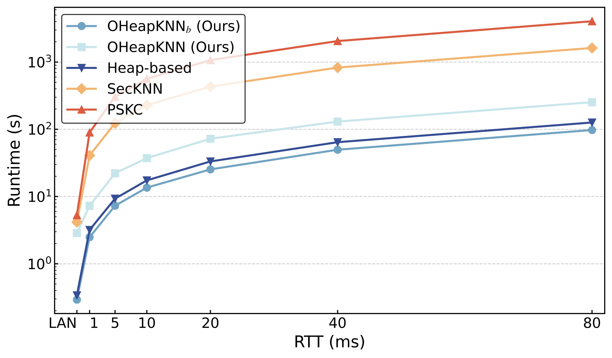
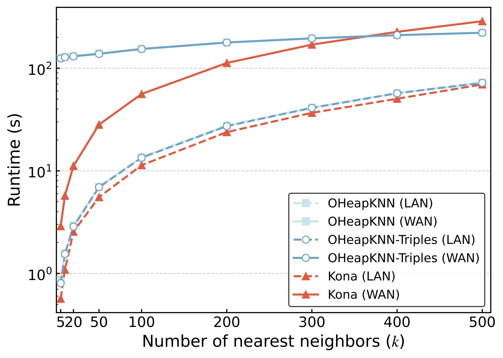
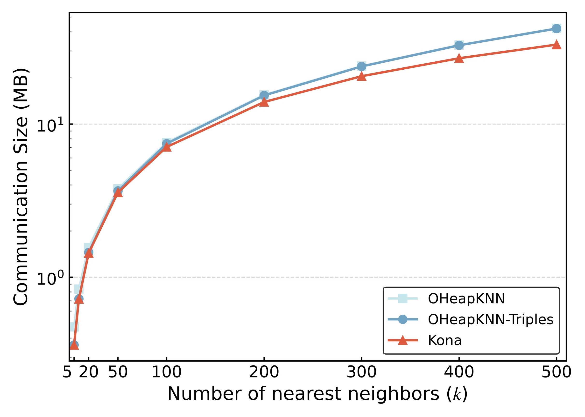

# OHeapKNN: Oblivious Heap-Enhanced Privacy-Preserving K-Nearest Neighbors Classification Over Outsourced Data

> 🚧 **Note**
> The code is still under active development and may be further refined in future updates.

---

## 📖 Introduction

This repository provides the implementation of **OHeapKNN**, a privacy-preserving **K-Nearest Neighbors (KNN)** classification framework designed for outsourced data scenarios.

OHeapKNN follows a two-server, semi-honest, non-colluding setting. It combines additive secret sharing (ASS), function secret sharing (FSS), and a novel **oblivious heap (OH)** to protect the dataset, the query, and the access patterns during classification.

---

## 🔑 Key Contributions

The main contributions of this work are summarized as follows:

### 1️⃣ Efficient Nearest Neighbors Selection Protocol

We propose a general protocol, **PPHS**, that satisfies the basic security goals by adopting a **parallel-path update strategy** inspired by heap-based designs.

- Reduces the communication rounds of top-k distance selection from **O(n log k)** to **O(n + log k)**.

### 2️⃣ Oblivious Heap Design

We design a novel **oblivious heap** to hide access patterns and propose the OH-enhanced **STDS** protocol.

- Enables **OH-enhanced OHeapKNN**.
- Reduces the communication rounds of top-k distance selection from **O(nk)** to **O(n + log k)**.
- Uses a fixed, data-independent CompareSwap schedule, so the execution trace does not depend on the input.

### 3️⃣ Correctness and Formal Security

The paper establishes correctness for PPHS, STDS, SPV, and OHeapKNNC, and proves security under the real/ideal-world paradigm and the UC framework for a semi-honest, non-colluding two-server setting. PPHS leaks access patterns by design; STDS hides them with a fixed schedule.

### 4️⃣ Extensive Experimental Evaluation

Experiments on six real-world UCI datasets show that OHeapKNN outperforms SecKNN and PSKC by **1.12×–136.75×** in runtime and **1.62×–115.74×** in communication rounds. The advantage grows with `k`, because OHeapKNN requires `O(n + log k)` rounds instead of `O(nk)`.

Key comparisons:

- **OHeapKNN vs. SecKNN:** **1.17×–53.55×** runtime speedup and **1.62×–46.29×** fewer communication rounds.
- **OHeapKNN vs. PSKC:** **1.12×–136.75×** runtime speedup and **4.11×–115.74×** fewer communication rounds.
- **OHeapKNN_b vs. heap-based:** **1.02×–2.57×** runtime speedup and **1.03×–2.69×** fewer communication rounds.
- **Accuracy:** OHeapKNN_b and OHeapKNN match the Scikit-learn baseline on all evaluated datasets.
- **Kona comparison:** Kona is faster for small `k`, while OHeapKNN's `O(n + log k)` rounds become advantageous for large `k`.

---

## ✅ Correctness and Security

- **Correctness:** the paper proves correctness of PPHS, STDS, SPV, and the full OHeapKNNC protocol, including deterministic distance and voting tie handling.
- **Security:** formal analysis under the real/ideal-world paradigm and the UC framework, for a semi-honest adversary corrupting at most one of two non-colluding servers.
- **Leakage:** PPHS intentionally reveals comparison outcomes and partial distance ordering; STDS hides access patterns with a fixed, data-independent schedule.

---

## 📊 Experimental Evaluation

### Setup

| Item | Configuration |
|---|---|
| Platform | Linux virtual machine, 8 vCPUs, Intel Core i5-12400F, 8 GB RAM |
| Libraries | GMP and Garnet (built on MP-SPDZ) |
| Network | LAN: 1024 Mbps, `< 1 ms` RTT; WAN: 40 Mbps, 40 ms RTT |
| Datasets | Iris, Glass Identification, Libras Movement, Breast Cancer, Spambase, EEG Eye State |
| Baselines | SecKNN, PSKC, Kona, heap-based scheme, Scikit-learn |
| Metrics | Communication rounds, communication size, runtime in LAN and WAN |

The datasets range from 150 samples with 4 attributes (Iris) to 14,980 samples with 14 attributes (EEG). The implementation uses a 64-bit ring and FSS-based comparison with an AES-128 counter-mode PRG; each party is simulated by a separate thread. Reported runtime and communication overhead are measured during the online phase.

### Main Results

| Comparison | Runtime speedup (LAN/WAN) | Communication-round reduction |
|---|---|---|
| OHeapKNN vs. SecKNN | 1.17×–53.55× | 1.62×–46.29× |
| OHeapKNN vs. PSKC | 1.12×–136.75× | 4.11×–115.74× |
| OHeapKNN_b vs. heap-based | 1.02×–2.57× | 1.03×–2.69× |

The ranges span the reported LAN and WAN results.

Additional observations from the evaluation:

- **Accuracy:** both OHeapKNN_b and OHeapKNN achieve the same accuracy as Scikit-learn on all six datasets (e.g., 96.67% on Iris and 95.99% on EEG at `k = 5`).
- **Communication size:** OHeapKNN reduces communication size by 1.01×–1.28× compared with PSKC. It is about 1%–5% larger than SecKNN because the oblivious-heap design performs additional secure comparisons, while OHeapKNN_b is slightly smaller than the heap-based scheme.
- **Kona tradeoff:** on EEG with `n = 1000`, Kona is faster in LAN and for the tested `k ≤ 300` in WAN. At `k = 500`, OHeapKNN achieves a 1.29× WAN speedup with fewer rounds (7028 vs. 10,497), although it transmits more data (42.148 MB vs. 33.022 MB). At `n = 10000` and `k = 10`, Kona needs 301 rounds versus 60,026 for OHeapKNN, with WAN runtimes of 16.20 s versus 1292.16 s. Kona's `O(k log n)` rounds favor small `k`, whereas OHeapKNN's `O(n + log k)` rounds favor large `k`.

### Figures

**Runtime under varying RTT (LAN to 80 ms).**



**Communication rounds versus the number of nearest neighbors `k`.**


**Runtime versus `k` on the EEG dataset in LAN and WAN.**



**Communication size versus `k`.**



---

## 🧩 Versions

This repository includes three implementations:

- **Heap-based**
  → Sequential heap update (baseline implementation).

- **OHeapKNN_b**
  → Parallel-path heap update (efficiency-optimized version). It does not hide access patterns.

- **OHeapKNN**
  → Oblivious heap-based implementation with access-pattern hiding.

> **Note:** The paper also evaluates **OHeapKNN-Triples**, which combines Kona-style Euclidean triples with STDS. It is an experimental comparison variant and is not included in the current release.

---

## 🧭 Discussion and Extensions

- **Multi-heap parallelism:** partitioning the distance vector into `s` segments and merging `s` heaps can reduce the STDS round complexity to `O((n + log k)/s + (k + log k) log s)`. The optimal `s` is approximately `n ln 2 / k`, giving roughly `O(k log n)` rounds at the cost of a constant-factor increase in communication.
- **Integration with other schemes:** PPHS, STDS, and the oblivious heap can be integrated into other heap-based KNN schemes, such as AMEKNN and ANGKNN.
- **Malicious security:** extending OHeapKNN to the malicious model, for example through key verification and replicated secret sharing, is left for future work.

---

## 📁 Code Structure

- `Heap-based.cpp`
  → Baseline implementation with sequential heap update.
- `OHeapKNN_b.cpp`
  → Implementation of OHeapKNN with **parallel-path heap update**, improving efficiency via level-wise batched operations.
- `OHeapKNN.cpp`
  → Full **oblivious heap-based implementation** of OHeapKNN, providing access-pattern hiding and stronger security guarantees.
- `figures/`
  → Experimental figures included in this README.

---

## 🔗 Dependencies

This project is developed based on the **Garnet framework**:

👉 https://github.com/FudanMPL/Garnet

Please refer to the original Garnet repository for:
- environment setup
- compilation instructions
- runtime configuration

---

## ▶️ How to Run

This section describes a complete Iris run from a fresh Garnet checkout. The three protocol sources must be placed inside the Garnet tree because they include Garnet headers such as `../Networking/Player.h`.

> **Note:** `FudanMPL/Garnet` is under active development. For exact reproduction, pin the Garnet revision used for your experiments. If you built against a Kona-specific Garnet fork, substitute its repository URL and commit while keeping the same layout. The commands below assume the `Machines/` layout and the `knn-party-offline.x` target are available, and are run from the Garnet root unless stated otherwise.

### 1. Environment

Use Ubuntu 20.04 or a compatible Linux distribution with Python 3.10+, and install the Garnet dependencies:

```bash
sudo apt-get update
sudo apt-get install -y automake build-essential cmake git \
    libboost-dev libboost-thread-dev libntl-dev libsodium-dev \
    libssl-dev libtool m4 texinfo yasm
```

### 2. Clone and build Garnet

```bash
git clone --recursive https://github.com/FudanMPL/Garnet.git
cd Garnet

make clean-deps boost libote
make clean
make -j8 tldr
```

### 3. Add the OHeapKNN sources

From the root of this repository, copy the three protocol sources into `Garnet/Machines/` and the scripts into the Garnet root:

```bash
cp OHeapKNN.cpp OHeapKNN_b.cpp Heap_based.cpp /path/to/Garnet/Machines/
cp KNN-experiment.sh LAN.sh WAN.sh /path/to/Garnet/
```

The expected layout is:

```text
Garnet/
├── Machines/
│   ├── OHeapKNN.cpp
│   ├── OHeapKNN_b.cpp
│   └── Heap_based.cpp
├── KNN-experiment.sh
├── LAN.sh
├── WAN.sh
└── Player-Data/
```

### 4. Prepare the Iris dataset

The current `main()` uses `dir = "knn-1/"` and `dataset_name_list = {"iris"}`, so place the preprocessed Iris files under:

```text
Garnet/Player-Data/Knn-Data/knn-1/iris-data/
├── Knn-meta
├── P0-0-X-Train
├── P0-0-Y-Train
├── P1-0-X-Test
└── P1-0-Y-Test
```

For an 8:2 train/test split of the 150 Iris samples, `Knn-meta` is:

```text
4 120 30
```

The first line means `num_features num_train_data num_test_data`. The current code reads only these three integers; additional lines are ignored.

File contents:

- `P0-0-X-Train`: 120 rows, each with 4 integer features.
- `P0-0-Y-Train`: 120 integer labels.
- `P1-0-X-Test`: 30 rows, each with 4 integer features.
- `P1-0-Y-Test`: 30 integer labels.
- No header rows; values are whitespace-separated.
- Normalize or scale features to integers before writing the files.

### 5. Generate the FSS keys

From the Garnet root:

```bash
make -j8 knn-party-offline.x
./knn-party-offline.x
```

The generator writes the FSS key files to:

```text
Player-Data/k0
Player-Data/k1
Player-Data/r0
Player-Data/r1
Player-Data/r2
```

OHeapKNN reads them from `Player-Data/2-fss/`, so copy them once:

```bash
mkdir -p Player-Data/2-fss
cp Player-Data/k0 Player-Data/k1 \
   Player-Data/r0 Player-Data/r1 Player-Data/r2 \
   Player-Data/2-fss/
```

`./knn-party-offline.x` may print `Knn-meta file Not Exist!` because its default dataset is `chronic`. The FSS keys are generated before the triple-generation stage, so this message does not prevent OHeapKNN from running. The `gen_fake_dcf()` implementation in `Machines/knn-party-offline.cpp` is the same as the one in `OHeapKNN.cpp` except for the output directory, so copying the keys is sufficient.

The current OHeapKNN code does not read the `...-Triples` files generated by the offline program. If you also need those triples for another scheme, set `dataset_name` and the `Knn-Data` path in `Machines/knn-party-offline.cpp` to `iris` / `knn-1` and rerun it.

### 6. Generate SSL certificates

```bash
./Scripts/setup-ssl.sh 2
```

### 7. Build and run OHeapKNN

Compile the target:

```bash
make -j8 OHeapKNN.x
```

`KNN-experiment.sh` runs `make clean` before building by default. Set `SKIP_CLEAN=1` to reuse existing objects; `JOBS`, `PORT`, and `HOST` can also be overridden.

LAN:

```bash
./LAN.sh 0
./KNN-experiment.sh LAN OHeapKNN
```

Emulated RTT, for example 5 ms:

```bash
./LAN.sh 5
./KNN-experiment.sh RTT5ms OHeapKNN
```

WAN:

```bash
./WAN.sh
./KNN-experiment.sh WAN OHeapKNN
```

Alternatively, launch the two parties manually in two terminals:

```bash
# Terminal 1 (P0)
./OHeapKNN.x 0 -pn 10000 -h localhost

# Terminal 2 (P1)
./OHeapKNN.x 1 -pn 10000 -h localhost
```

`KNN-experiment.sh` stores build logs, per-party logs, and a summary in:

```text
KNN-experiment-res-<TAG>/
```

### 8. Expected output

Each party prints fields such as:

```text
Prediction accuracy : ...
Total Round count = ...
Party total time = ... seconds
Party Data sent = ... MB
```

### 9. Parameters

The defaults are:

```cpp
const int K = 64;              // ring size
const int k_const = 5;         // number of nearest neighbors
dir = "knn-1/";
vector<string> dataset_name_list = {"iris"};
```

To run another dataset, update `dir` and `dataset_name_list` in all three `.cpp` files, then place its files under the matching `Player-Data/Knn-Data/<dir>/<dataset>-data/` directory. If the offline generator is also used, keep its `dataset_name` and paths consistent.

### 10. Troubleshooting

- `Knn-meta file Not Exist!`: the dataset is missing, or `knn-party-offline.cpp` still points to `chronic`. Check the path.
- `Player-Data/2-fss/r0` is missing: copy the keys as shown in step 5.
- `Makefile` not found: run the commands from the Garnet root, not from this repository root.
- `tc: command not found` or permission errors: install `iproute2` and run `LAN.sh` / `WAN.sh` with `sudo`.
- `Address already in use`: choose another `PORT` (for example `PORT=10001 ./KNN-experiment.sh ...`) and update the `tc` filters if necessary.

For the original Garnet KNN data-format reference, see:

👉 https://github.com/FudanMPL/Garnet/blob/main/docs/knn.md


---

## 📚 References

> [1] G. Lin, R. Zhou, S. Chen, W. Han, J. Tan, W. Fang, L. Wang, and T. Wei, *Kona: An Efficient Privacy-Preservation Framework for KNN Classification by Communication Optimization*, _ICML_ 2025. (Kona)

> [2] Z. Li, H. Wang, S. Zhang, W. Zhang, and R. Lu, *SecKNN: FSS-Based Secure Multi-Party KNN Classification Under General Distance Functions*, _IEEE TIFS_, 2024. (SecKNN)

> [3] L. Liu et al., *Toward Highly Secure yet Efficient KNN Classification Scheme on Outsourced Cloud Data*, _IEEE Internet of Things Journal_, 2019. (PSKC)

> [4] H. Morita et al., *Constant-Round Client-Aided Secure Comparison Protocol*, _ESORICS_ 2018.

> [5] F. Pedregosa et al., *Scikit-learn: Machine Learning in Python*, _JMLR_, 2011.

---

## 📜 License & Acknowledgment

This project is built upon the open-source [Garnet framework](https://github.com/FudanMPL/Garnet).

Garnet is released under the BSD 3-Clause License. This project is distributed in compliance with the licensing requirements of Garnet.

The Garnet framework incorporates several third-party components, including:
- MP-SPDZ
- SPDZ-2
- SPDZ-BMR-ORAM
- SCALE-MAMBA
- NFGen

These components are distributed under their respective open-source licenses.  
For detailed licensing information, please refer to the original Garnet repository.

---

## ⚠️ Disclaimer

This code is provided **"as is"**, without warranty of any kind, express or implied, including but not limited to the warranties of merchantability and fitness for a particular purpose.

In no event shall the authors or contributors be liable for any damages arising from the use of this software.

---

## 📬 Contact

If you have any questions regarding this project, please open an issue in this GitHub repository.

If your issue is not addressed promptly, you may also contact us via email at: rantong@stu.scu.edu.cn

---

## 📌 Notes

- This code is intended for **research and experimental purposes**.
- If you use this work in your research, please cite the accompanying paper (under review; citation details will be updated upon publication).
