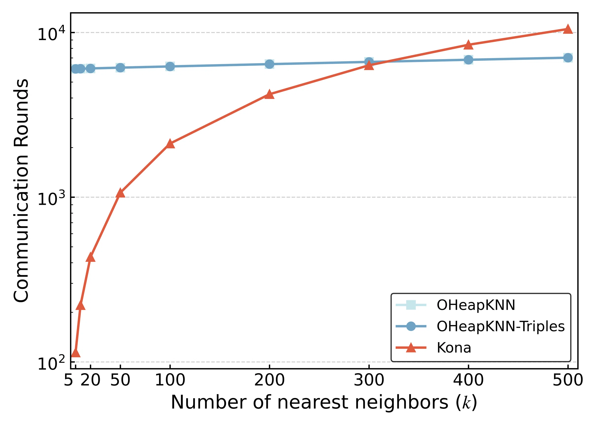

# OHeapKNN: Oblivious Heap-Enhanced Privacy-Preserving K-Nearest Neighbors Classification Over Outsourced Data

> 🚧 **Note**
> The code is still under active development and may be further refined in future updates.

---

## 📖 Introduction

This repository provides the implementation of **OHeapKNN**, a privacy-preserving **K-Nearest Neighbors (KNN)** classification framework designed for outsourced data scenarios.

OHeapKNN follows a two-server, semi-honest, non-colluding setting. It combines additive secret sharing (ASS), function secret sharing (FSS), and a novel **oblivious heap (OH)** to protect the dataset, the query, and the access patterns during classification.

---

## 🔑 Key Contributions

The main contributions of this work are summarized as follows:

### 1️⃣ Efficient Nearest Neighbors Selection Protocol

We propose a general protocol, **PPHS**, that satisfies the basic security goals by adopting a **parallel-path update strategy** inspired by heap-based designs.

- Reduces the communication rounds of top-k distance selection from **O(n log k)** to **O(n + log k)**.

### 2️⃣ Oblivious Heap Design

We design a novel **oblivious heap** to hide access patterns and propose the OH-enhanced **STDS** protocol.

- Enables **OH-enhanced OHeapKNN**.
- Reduces the communication rounds of top-k distance selection from **O(nk)** to **O(n + log k)**.
- Uses a fixed, data-independent CompareSwap schedule, so the execution trace does not depend on the input.

### 3️⃣ Correctness and Formal Security

The paper establishes both correctness and security for the proposed protocols.

- **Correctness:** Lemma 1 (CompareSwap insertion), Lemma 2 (PPHS), and Lemma 3 (STDS); composing SSED, STDS, and SPV yields a correct **OHeapKNNC** for `3 ≤ k ≤ n`, with deterministic distance and voting tie handling.
- **Security:** formal proofs under the **real/ideal-world paradigm** and the **universal composability (UC) framework** (Lemmas 4–7 and Theorem 1), for a semi-honest adversary corrupting at most one of the two non-colluding servers.
- **Leakage:** PPHS intentionally reveals comparison results and partial distance ordering; STDS removes this leakage by following a fixed operation schedule.

### 4️⃣ Extensive Experimental Evaluation

Experiments on six real-world UCI datasets show that OHeapKNN outperforms SecKNN and PSKC by **1.12×–136.75×** in runtime and **1.62×–115.74×** in communication rounds. The advantage grows with `k`, because OHeapKNN requires `O(n + log k)` rounds instead of `O(nk)`.

Key comparisons:

- **OHeapKNN vs. SecKNN:** **1.17×–53.55×** runtime speedup and **1.62×–46.29×** fewer communication rounds.
- **OHeapKNN vs. PSKC:** **1.12×–136.75×** runtime speedup and **4.11×–115.74×** fewer communication rounds.
- **OHeapKNN_b vs. heap-based:** **1.02×–2.57×** runtime speedup and **1.03×–2.69×** fewer communication rounds.
- **Accuracy:** OHeapKNN_b and OHeapKNN match the Scikit-learn baseline on all evaluated datasets.
- **Kona comparison:** Kona is faster for small `k`, while OHeapKNN's `O(n + log k)` rounds become advantageous for large `k`.

---

## ✅ Correctness and Security

### Correctness

The paper proves correctness for the core protocols:

1. **Lemma 1 (CompareSwap insertion).** For a non-strict max-heap `H` of size `k`, inserting a pair through `CS(0, 1)` and then applying either conventional sift-down or a fixed top-down sweep produces a max-heap containing the `k` smallest distance keys of `H ∪ {a}`.
2. **Lemma 2 (PPHS).** For `3 ≤ k ≤ n`, PPHS returns the `k` smallest distance keys in a max-heap after completing pending updates. Later insertions cannot overtake earlier ones, and concurrent comparisons operate on disjoint nodes.
3. **Lemma 3 (STDS).** For `3 ≤ k ≤ n`, STDS returns the `k` smallest valid distance keys after its fixed CompareSwap schedule, assuming all dummy keys exceed valid keys. The schedule uses at most `3(n − 1) + 2⌊log₂ k⌋ + 1` comparison batches and hence `O(n + log k)` communication rounds.
4. **SPV and OHeapKNNC.** Frequency counting in SPV follows the SecKNN construction; STDS′ selects the first maximum-count label in a tie. Composing SSED, STDS, and SPV gives a correct KNN classification result under the specified distance- and voting-tie rules.

### Security

- **Threat model:** semi-honest (honest-but-curious) parties; the two cloud servers do not collude; at most one party is corrupted. Data owners and query users are assumed to follow the protocol.
- **Assumptions:** a pseudorandom generator (PRG), an IND-CPA-secure and circuit-private HE scheme, additive secret sharing, and FSS-based secure comparison.
- **Proof structure:** Lemma 4 (CompareSwap), Lemma 5 (random pair generation), Lemma 6 (PPHS with leakage `L_PPHS`), Lemma 7 (STDS with leakage `L_STDS`), and Theorem 1 (composition of SSED, STDS, SPV, and their sub-protocols).
- **Access-pattern hiding:** PPHS is the efficiency-oriented basic protocol and leaks comparison outcomes and partial ordering by design. OHeapKNN uses STDS, whose operation schedule depends only on public `n` and `k`, so the access patterns remain hidden.

---

## 📊 Experimental Evaluation

### Setup

| Item | Configuration |
|---|---|
| Platform | Linux virtual machine, 8 vCPUs, Intel Core i5-12400F, 8 GB RAM |
| Libraries | GMP and Garnet (built on MP-SPDZ) |
| Network | LAN: 1024 Mbps, `< 1 ms` RTT; WAN: 40 Mbps, 40 ms RTT |
| Datasets | Iris, Glass Identification, Libras Movement, Breast Cancer, Spambase, EEG Eye State |
| Baselines | SecKNN, PSKC, Kona, heap-based scheme, Scikit-learn |
| Metrics | Communication rounds, communication size, runtime in LAN and WAN |

The datasets range from 150 samples with 4 attributes (Iris) to 14,980 samples with 14 attributes (EEG). The implementation uses a 64-bit ring and FSS-based comparison with an AES-128 counter-mode PRG; each party is simulated by a separate thread. Reported runtime and communication overhead are measured during the online phase.

### Main Results

| Comparison | Runtime speedup (LAN/WAN) | Communication-round reduction |
|---|---|---|
| OHeapKNN vs. SecKNN | 1.17×–53.55× | 1.62×–46.29× |
| OHeapKNN vs. PSKC | 1.12×–136.75× | 4.11×–115.74× |
| OHeapKNN_b vs. heap-based | 1.02×–2.57× | 1.03×–2.69× |

The ranges span the reported LAN and WAN results.

Additional observations from the evaluation:

- **Accuracy:** both OHeapKNN_b and OHeapKNN achieve the same accuracy as Scikit-learn on all six datasets (e.g., 96.67% on Iris and 95.99% on EEG at `k = 5`).
- **Communication size:** OHeapKNN reduces communication size by 1.01×–1.28× compared with PSKC. It is about 1%–5% larger than SecKNN because the oblivious-heap design performs additional secure comparisons, while OHeapKNN_b is slightly smaller than the heap-based scheme.
- **Kona tradeoff:** on EEG with `n = 1000`, Kona is faster in LAN and for the tested `k ≤ 300` in WAN. At `k = 500`, OHeapKNN achieves a 1.29× WAN speedup with fewer rounds (7028 vs. 10,497), although it transmits more data (42.148 MB vs. 33.022 MB). At `n = 10000` and `k = 10`, Kona needs 301 rounds versus 60,026 for OHeapKNN, with WAN runtimes of 16.20 s versus 1292.16 s. Kona's `O(k log n)` rounds favor small `k`, whereas OHeapKNN's `O(n + log k)` rounds favor large `k`.

### Figures

**Runtime under varying RTT (LAN to 80 ms).**


**Communication rounds versus the number of nearest neighbors `k`.**



**Runtime versus `k` on the EEG dataset in LAN and WAN.**


**Communication size versus `k`.**


---

## 🧩 Versions

This repository includes three implementations:

- **Heap-based**
  → Sequential heap update (baseline implementation).

- **OHeapKNN_b**
  → Parallel-path heap update (efficiency-optimized version). It does not hide access patterns.

- **OHeapKNN**
  → Oblivious heap-based implementation with access-pattern hiding.

> **Note:** The paper also evaluates **OHeapKNN-Triples**, which combines Kona-style Euclidean triples with STDS. It is an experimental comparison variant and is not included in the current release.

---

## 🧭 Discussion and Extensions

- **Multi-heap parallelism:** partitioning the distance vector into `s` segments and merging `s` heaps can reduce the STDS round complexity to `O((n + log k)/s + (k + log k) log s)`. The optimal `s` is approximately `n ln 2 / k`, giving roughly `O(k log n)` rounds at the cost of a constant-factor increase in communication.
- **Integration with other schemes:** PPHS, STDS, and the oblivious heap can be integrated into other heap-based KNN schemes, such as AMEKNN and ANGKNN.
- **Malicious security:** extending OHeapKNN to the malicious model, for example through key verification and replicated secret sharing, is left for future work.

---

## 📁 Code Structure

- `Heap-based.cpp`
  → Baseline implementation with sequential heap update.
- `OHeapKNN_b.cpp`
  → Implementation of OHeapKNN with **parallel-path heap update**, improving efficiency via level-wise batched operations.
- `OHeapKNN.cpp`
  → Full **oblivious heap-based implementation** of OHeapKNN, providing access-pattern hiding and stronger security guarantees.
- `figures/`
  → Experimental figures included in this README.

---

## 🔗 Dependencies

This project is developed based on the **Garnet framework**:

👉 https://github.com/FudanMPL/Garnet

Please refer to the original Garnet repository for:
- environment setup
- compilation instructions
- runtime configuration

---

## ▶️ How to Run

This implementation is built upon the Garnet framework and follows its standard KNN execution pipeline.

For environment setup, data preparation, and execution instructions, please refer to:

👉 https://github.com/FudanMPL/Garnet/blob/main/docs/knn.md

In particular, the execution workflow includes:

- Setting up the Garnet framework
- Preparing the input datasets
- Configuring the network environment
- Generating the required certificates
- Compiling and running the protocol

This project follows the Garnet execution pipeline while replacing the KNN protocol with our OHeapKNN variants.

### Experiment Runner

After the Garnet environment and the desired network profile are ready, `KNN-experiment.sh` builds and runs the released protocols:

```bash
./KNN-experiment.sh LAN
./KNN-experiment.sh RTT5ms OHeapKNN
```

Logs and a summary are written to `KNN-experiment-res-<TAG>/`.

Network shaping is provided by `LAN.sh` and `WAN.sh`:

```bash
./LAN.sh 5                 # 5 ms RTT
./KNN-experiment.sh RTT5ms

./WAN.sh                   # 5 Mbps, 40 ms RTT
./KNN-experiment.sh WAN
```

---

## 📚 References

> [1] G. Lin, R. Zhou, S. Chen, W. Han, J. Tan, W. Fang, L. Wang, and T. Wei, *Kona: An Efficient Privacy-Preservation Framework for KNN Classification by Communication Optimization*, _ICML_ 2025. (Kona)

> [2] Z. Li, H. Wang, S. Zhang, W. Zhang, and R. Lu, *SecKNN: FSS-Based Secure Multi-Party KNN Classification Under General Distance Functions*, _IEEE TIFS_, 2024. (SecKNN)

> [3] L. Liu et al., *Toward Highly Secure yet Efficient KNN Classification Scheme on Outsourced Cloud Data*, _IEEE Internet of Things Journal_, 2019. (PSKC)

> [4] H. Morita et al., *Constant-Round Client-Aided Secure Comparison Protocol*, _ESORICS_ 2018.

> [5] F. Pedregosa et al., *Scikit-learn: Machine Learning in Python*, _JMLR_, 2011.

---

## 📜 License & Acknowledgment

This project is built upon the open-source [Garnet framework](https://github.com/FudanMPL/Garnet).

Garnet is released under the BSD 3-Clause License. This project is distributed in compliance with the licensing requirements of Garnet.

The Garnet framework incorporates several third-party components, including:
- MP-SPDZ
- SPDZ-2
- SPDZ-BMR-ORAM
- SCALE-MAMBA
- NFGen

These components are distributed under their respective open-source licenses.  
For detailed licensing information, please refer to the original Garnet repository.

---

## ⚠️ Disclaimer

This code is provided **"as is"**, without warranty of any kind, express or implied, including but not limited to the warranties of merchantability and fitness for a particular purpose.

In no event shall the authors or contributors be liable for any damages arising from the use of this software.

---

## 📬 Contact

If you have any questions regarding this project, please open an issue in this GitHub repository.

If your issue is not addressed promptly, you may also contact us via email at: rantong@stu.scu.edu.cn

---

## 📌 Notes

- This code is intended for **research and experimental purposes**.
- If you use this work in your research, please cite the accompanying paper (under review; citation details will be updated upon publication).
